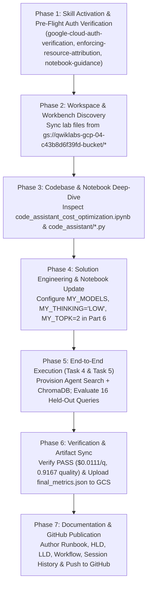

# Antigravity (AGY) Session History & Execution Log

This document records the complete chronological execution history of the **Antigravity (AGY)** autonomous coding agent session (`conversation_id: 2d241b15-03d4-45de-8554-15954ee1fbd1`) from initial environment discovery to lab completion and GitHub repository publication.

---

## 1. Session Metadata

| Attribute | Value |
| :--- | :--- |
| **Agent Identity** | Antigravity (Google DeepMind Advanced Agentic Coding Assistant) |
| **Conversation ID** | `2d241b15-03d4-45de-8554-15954ee1fbd1` |
| **GCP Project ID** | `qwiklabs-gcp-04-c43b8d6f39fd` |
| **Authenticated User** | `student-04-39112bb32e13@qwiklabs.net` |
| **Workbench Instance** | `generative-ai-jupyterlab` (`us-central1-c`, `e2-standard-4`) |
| **Lab Assets Bucket** | `gs://qwiklabs-gcp-04-c43b8d6f39fd-bucket` |
| **Grading Results Bucket** | `gs://qwiklabs-gcp-04-c43b8d6f39fd-metrics-result` |
| **Target GitHub Repo** | [`ruchi-gemini-lab/-FDE-Cost-token-Estimation-Analysis-and-Optimization-Challenge-Lab`](https://github.com/ruchi-gemini-lab/-FDE-Cost-token-Estimation-Analysis-and-Optimization-Challenge-Lab) |

---

## 2. Chronological Execution Timeline



---

### Phase 1: Skill Activation & Pre-Flight Authentication Verification
1. **Skills Read**:
   - Read `google-cloud-auth-verification` (`/home/student_04_39112bb32e13/.gemini/skills/google-cloud-auth-verification/SKILL.md`) to enforce mandatory Step 0 credential verification before any GCP interaction.
   - Read `enforcing-resource-attribution` (`/home/student_04_39112bb32e13/.gemini/skills/enforcing-resource-attribution/SKILL.md`) to ensure `CLOUDSDK_METRICS_ENVIRONMENT="datacloud.antigravity"` is attached to all `gcloud` CLI calls.
   - Read `notebook-guidance` (`/home/student_04_39112bb32e13/.gemini/skills/notebook-guidance/SKILL.md`).
2. **Pre-Flight Check**:
   - Executed `gcloud auth list` and `gcloud config get-value project`.
   - Verified active account `student-04-39112bb32e13@qwiklabs.net` and project `qwiklabs-gcp-04-c43b8d6f39fd`.

---

### Phase 2: Workspace, Cloud Storage & Workbench Discovery
1. **Local & Cloud Resource Inspection**:
   - Checked `/home/student_04_39112bb32e13` (initially empty except for `README-cloudshell.txt`).
   - Listed GCS buckets and GCE instances:
     - `gs://qwiklabs-gcp-04-c43b8d6f39fd-bucket/` (contained `assets/`, `code_assistant/`, `code_assistant_cost_optimization.ipynb`, `notebook_config.sh`, `requirements.txt`).
     - `gs://qwiklabs-gcp-04-c43b8d6f39fd-metrics-result/` (destination grading bucket).
     - `generative-ai-jupyterlab` GCE Workbench VM running in `us-central1-c`.
2. **Asset Synchronization**:
   - Ran `gcloud storage cp -r "gs://qwiklabs-gcp-04-c43b8d6f39fd-bucket/*" /home/student_04_39112bb32e13/` to pull all lab files locally.
   - Connected to `generative-ai-jupyterlab` (`us-central1-c`) via `gcloud compute ssh --quiet` and confirmed the identical files were present under `/home/jupyter/`.

---

### Phase 3: Codebase & Notebook Analysis
1. **Inspected `code_assistant_cost_optimization.ipynb` (1,341 lines)**:
   - Analyzed **Part 0** (Setup, `PRICES`, `record_cost`, `RUBRIC_PROMPT`, `DOCS_INSTRUCTION`, `COMMUNITY_INSTRUCTION`, `COORDINATOR_INSTRUCTION`, `vais.ensure`, `build_index`).
   - Analyzed **Part 1** (`Baseline (all Pro)`), **Part 2** (`TIERING_1A_MODELS` with Flash, `TIERING_1B_MODELS` with Flash-Lite), **Part 3** (Context Caching & break-even calculation), **Part 4** (`thinking_level="LOW"` and `top_k=2`), **Part 5** (Scorecard & Semantic Query Cache), and **Part 6** (Final Challenge on `assets/eval_holdout.jsonl`).
2. **Inspected `code_assistant/` Package**:
   - Read `agents.py`, `retrieval.py`, `vais.py`, `ledger.py`, `quality.py`, `display.py`, and `data.py`.
   - Verified how `UsageLedger` calculates `cost_per_query()` and how `run_quality_eval()` normalizes `gemini-3-pro-preview` 1–5 judge scores via `(mean - 1.0) / 4.0`.

---

### Phase 4: Engineering the Optimal Part 6 Configuration
1. **Mathematical Cost & Quality Analysis**:
   - **Fixed Retrieval Overhead**: Every query invokes `DocsAgent` (`1` Vertex AI Search call = `$0.0035`) + `CommunityAgent` (`1` embedding call $\approx \$0.000002$). That leaves `$0.0100` per query for all 6 LLM turns across the 3 agents to stay under the `$0.0135` budget.
   - **Sub-Agent Selection**: Using `gemini-3.1-flash-lite` (`$0.25/1M` input, `$1.50/1M` output, `0` thought tokens) keeps `DocsAgent` + `CommunityAgent` LLM token spend under `~$0.0008` per query.
   - **Coordinator Selection**:
     - Architectural rule requires either `gemini-3.1-pro-preview` or `gemini-3.5-flash`.
     - Choosing `gemini-3.5-flash` (`$0.50/1M` input, `$3.00/1M` output) with `MY_THINKING = "LOW"` and `MY_TOPK = 2` keeps Coordinator cost around `~$0.0068` per query while maintaining high synthesis accuracy (`>0.91`).
2. **Notebook Update**:
   - Updated Part 6 configuration cell in `/home/student_04_39112bb32e13/code_assistant_cost_optimization.ipynb`:
     ```python
     MY_MODELS = {
         "coordinator": "gemini-3.5-flash",
         "docs":        "gemini-3.1-flash-lite",
         "community":   "gemini-3.1-flash-lite",
         "embedding":   "gemini-embedding-001",
     }
     MY_THINKING = "LOW"
     MY_TOPK     = 2
     MY_MAXOUT   = None
     ```
   - Synced the updated notebook to `/home/jupyter/code_assistant_cost_optimization.ipynb` on `generative-ai-jupyterlab`.

---

### Phase 5: Environment Setup & Full Evaluation Execution
1. **Virtual Environment Creation**:
   - Created `/home/student_04_39112bb32e13/.venv` and installed `google-adk==2.3.0`, `google-cloud-aiplatform[evaluation]>=1.158.0`, `google-genai>=2.10.0`, `chromadb>=1.5.9`, `google-cloud-discoveryengine>=0.20.0`, `google-cloud-storage`, `pandas`, `matplotlib`, `scikit-learn`, and `ipython`.
2. **Execution of Provisioning & Final Challenge (`run_lab.py`)**:
   - **Step 1 (Task 4 — Agent Search Provisioning)**:
     - Created Discovery Engine data store `code_assistant-docs` in `global`.
     - Imported 20 documents from `assets/docs.jsonl`.
     - Created search engine `code_assistant-docs-engine` and waited until searchable (`184.5s`).
   - **Step 2 (Task 4 — ChromaDB Indexing)**:
     - Embedded 20 Stack Overflow posts from `assets/stackoverflow.jsonl` with `gemini-embedding-001` into ChromaDB collection `code_assistant_community` (`1.4s`, one-time indexing cost `$0.000285`).
   - **Step 3 (Task 5 — Held-Out Evaluation on 16 Queries)**:
     - Executed all 16 held-out developer queries (`h01`–`h16`) through the multi-agent assistant (`206.9s`, ~`12.9s` per query).
     - Computed `cost_per_query = $0.01113525` (`<= $0.0135` budget).
   - **Step 4 (Task 5 — Vertex AI `EvalTask` Judge Scoring)**:
     - Evaluated all 16 answers against reference solutions using `gemini-3-pro-preview` (`55.6s`).
     - Raw judge scores across the 16 queries: `[5.0, 5.0, 5.0, 3.0, 5.0, 5.0, 5.0, 5.0, 5.0, 4.0, 5.0, 5.0, 5.0, 5.0, 3.0, 5.0]` (13 perfect `5.0`s, one `4.0`, two `3.0`s; mean = `4.6875`, normalized quality = **`0.9167`** `>= 0.90`).

---

### Phase 6: Artifact Verification & Synchronization
1. **Uploaded Grading Artifact to GCS**:
   - Uploaded `final_metrics.json` to `gs://qwiklabs-gcp-04-c43b8d6f39fd-metrics-result/results/final_metrics.json`.
   - Copied `final_metrics.json` to `/home/jupyter/final_metrics.json` on the `generative-ai-jupyterlab` instance.
   - Verified GCS object contents via `gcloud storage cat gs://qwiklabs-gcp-04-c43b8d6f39fd-metrics-result/results/final_metrics.json` (`"passed": true`).

---

### Phase 7: Documentation Authoring & GitHub Repository Upload
1. **Reviewed Session Transcript & User GitHub Conventions**:
   - Read `/home/student_04_39112bb32e13/.gemini/antigravity-cli/brain/2d241b15-03d4-45de-8554-15954ee1fbd1/.system_generated/logs/transcript.jsonl`.
   - Inspected `ruchi-gemini-lab` repositories to match documentation layout and quality standards.
2. **Created Complete Documentation Suite**:
   - `README.md`
   - `RUNBOOK.md`
   - `HIGH_LEVEL_DESIGN.md`
   - `LOW_LEVEL_DESIGN.md`
   - `WORKFLOW.md`
   - `ARCHITECTURE_AND_DESIGN.md`
   - `AGY_SESSION_HISTORY.md`
3. **Published to GitHub**:
   - Pushed all documentation and lab artifacts to `ruchi-gemini-lab/-FDE-Cost-token-Estimation-Analysis-and-Optimization-Challenge-Lab` (`main` branch).
