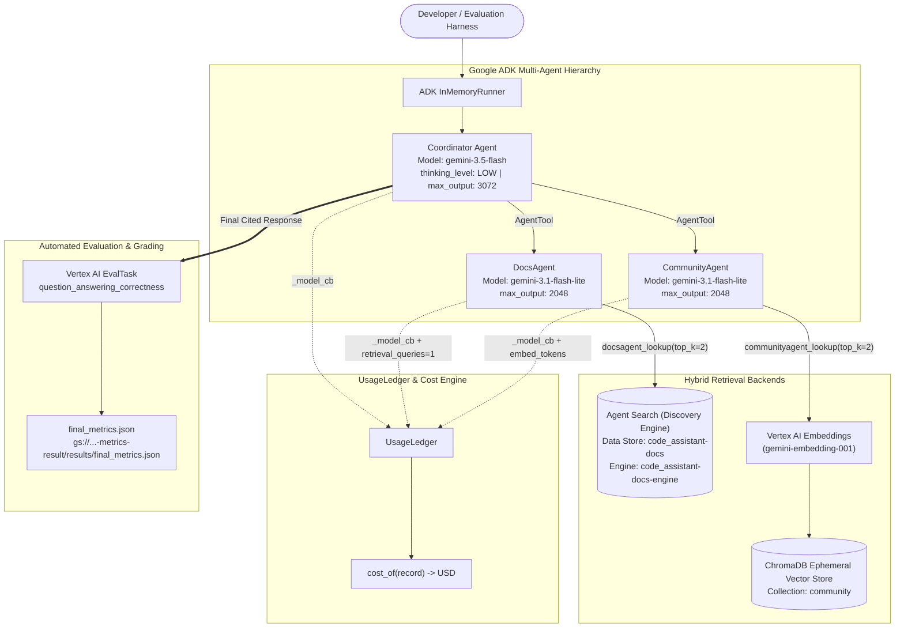

# Master Architecture & Design Specification: Code Assistant Agent Cost Optimization

This unified engineering document consolidates the **High-Level Design (HLD)**, **Low-Level Design (LLD)**, and **End-to-End Operational Workflows** for the **Code Assistant Agent Cost Measurement & Optimization** system.

> For modular standalone documents, see:
> - [**`HIGH_LEVEL_DESIGN.md`**](./HIGH_LEVEL_DESIGN.md)
> - [**`LOW_LEVEL_DESIGN.md`**](./LOW_LEVEL_DESIGN.md)
> - [**`WORKFLOW.md`**](./WORKFLOW.md)
> - [**`RUNBOOK.md`**](./RUNBOOK.md)
> - [**`AGY_SESSION_HISTORY.md`**](./AGY_SESSION_HISTORY.md)

---

## Part I: High-Level Design (HLD)

### 1. Problem Statement & System Objectives
When a developer asks a question to a multi-agent code assistant, a single query fans out into multiple Coordinator reasoning turns, sub-agent delegations, managed search queries, vector embedding lookups, and thousands of internal `thought_tokens`. Running the baseline configuration (`gemini-3.1-pro-preview` Coordinator + `gemini-3.5-flash` sub-agents with `thinking_level="HIGH"`) yields high answer quality (`~0.94`), but costs **`~$0.025+` per query**—nearly double the production budget of **`$0.0135` per query**.

Our architecture solves this by pairing:
1. **A Hierarchical Multi-Agent Assistant (Google ADK)**: A `Coordinator` orchestrating `DocsAgent` (official documentation via Agent Search) and `CommunityAgent` (Stack Overflow discussions via ChromaDB).
2. **A Zero-Blind-Spot FinOps Ledger (`UsageLedger`)**: Capturing uncached input tokens, cached input tokens, visible output tokens, reasoning (`thought`) tokens, embedding tokens, and Agent Search query fees per agent and per `query_id`.
3. **An Automated LLM-as-a-Judge Quality Gate (`EvalTask`)**: Scoring every experiment against ground-truth reference answers using `PointwiseMetric(metric="question_answering_correctness")` on a 1–5 correctness/completeness rubric normalized to `[0.0, 1.0]`.
4. **Three Cost-Reduction Levers**: Model Tiering, Context Caching, and Reasoning (`thinking_level="LOW"`) + Retrieval (`top_k=2`) Token Reduction.

### 2. End-to-End Architecture Diagram



---

## Part II: Low-Level Design (LLD)

### 1. Module Inventory (`code_assistant/`)

| File | Responsibility | Key Symbols |
| :--- | :--- | :--- |
| [`code_assistant/ledger.py`](./code_assistant/ledger.py) | Stores per-call token & retrieval records and aggregates cost breakdowns. | `UsageLedger`, `add()`, `to_df()`, `total_cost()`, `cost_per_query()`, `cost_breakdown()`, `reset()` |
| [`code_assistant/agents.py`](./code_assistant/agents.py) | Constructs the ADK `Coordinator`, `DocsAgent`, and `CommunityAgent`, registers `after_model_callback`, and executes queries via `InMemoryRunner`. | `build_code_assistant()`, `answer_query()`, `_model_cb()`, `SUBAGENT_MAX_OUTPUT`, `COORDINATOR_MAX_OUTPUT` |
| [`code_assistant/retrieval.py`](./code_assistant/retrieval.py) | Generates embeddings with `gemini-embedding-001`, indexes Stack Overflow posts into ChromaDB, and builds ADK lookup tools. | `genai_client()`, `embed_texts()`, `build_index()`, `make_lookup_tool()` |
| [`code_assistant/vais.py`](./code_assistant/vais.py) | Idempotently provisions the Discovery Engine Data Store (`code_assistant-docs`) and Engine (`code_assistant-docs-engine`), imports `docs.jsonl`, and executes searches. | `ensure()`, `provision()`, `search()`, `wait_until_searchable()`, `make_vais_lookup_tool()` |
| [`code_assistant/quality.py`](./code_assistant/quality.py) | Runs `vertexai.evaluation.EvalTask` and normalizes 1–5 rubric ratings to `[0.0, 1.0]`. | `run_quality_eval()`, `CRITERIA`, `RATING_RUBRIC`, `CORRECTNESS_METRIC` |
| [`code_assistant/display.py`](./code_assistant/display.py) | Renders HTML metric cards and PASS/FAIL banners in Jupyter. | `show_result()`, `show_verdict()`, `show_target()` |
| [`code_assistant/data.py`](./code_assistant/data.py) | Reads `.jsonl` corpus and evaluation datasets into lists of dicts. | `load_jsonl()` |

### 2. Pricing Table & Cost Formula

| Resource / Model Tier | Input Price (per 1M tokens) | Cached Input Price (per 1M tokens) | Output & Thought Price (per 1M tokens) | Per-Request Fee |
| :--- | ---: | ---: | ---: | ---: |
| `gemini-3.1-pro-preview` | `$2.00` | `$0.20` (`0.10x`) | `$12.00` | — |
| `gemini-3.5-flash` | `$1.50` | `$0.15` (`0.10x`) | `$9.00` | — |
| `gemini-3.1-flash-lite` | `$0.25` | `$0.025` (`0.10x`) | `$1.50` | — |
| `gemini-2.5-pro` | `$1.25` | `$0.13` (`0.10x`) | `$10.00` | — |
| `gemini-2.5-flash` | `$0.30` | `$0.03` (`0.10x`) | `$2.50` | — |
| `gemini-embedding-001` | `$0.15` | — | — | — |
| `vais_query` (Agent Search) | — | — | — | `$0.0015` (`$1.50 / 1,000` queries) |

```python
def cost_of(record):
    ct = record.get("call_type")
    if ct == "model":
        p = PRICING[record["model"]]
        out = record.get("output_tokens", 0) + record.get("thought_tokens", 0)
        return round((record.get("input_tokens", 0) * p["input"]
                      + record.get("cached_tokens", 0) * p["cached"]
                      + out * p["output"]) / 1e6, 12)
    if ct == "embedding":
        return round(record.get("embed_tokens", 0) * PRICING["embedding"]["per_1m_tokens"] / 1e6, 12)
    if ct == "retrieval":
        return round(record.get("retrieval_queries", 0) * PRICING["vais_query"]["per_1k_queries"] / 1e3, 12)
    return 0.0
```

---

## Part III: Execution & Optimization Workflow

### 1. Per-Query Fan-Out Sequence
1. `answer_query()` sets `qid_holder["v"] = query_id` and starts `InMemoryRunner`.
2. **Coordinator Turn 1**: Plans retrieval strategy and invokes `DocsAgent` and `CommunityAgent` via `AgentTool`.
3. **DocsAgent Turn 1 & Tool Call**: Calls `docsagent_lookup(query)` (`top_k=2`), logging `retrieval_queries=1` (`$0.0015`) to `UsageLedger`, then summarizes the 2 official doc passages in **DocsAgent Turn 2**.
4. **CommunityAgent Turn 1 & Tool Call**: Calls `communityagent_lookup(query)` (`top_k=2`), embedding the query via `gemini-embedding-001` (logging `embed_tokens` to `UsageLedger`), querying ChromaDB, and summarizing the 2 Stack Overflow posts in **CommunityAgent Turn 2**.
5. **Coordinator Turn 2**: Synthesizes both grounded summaries into a final cited response.

### 2. Final Challenge Configuration & Results (`Part 6`)
By configuring:
- `MY_MODELS = {"coordinator": "gemini-3.5-flash", "docs": "gemini-3.1-flash-lite", "community": "gemini-3.1-flash-lite", "embedding": "gemini-embedding-001"}`
- `MY_THINKING = "LOW"`
- `MY_TOPK = 2`
- `MY_MAXOUT = None`

We achieve on the 16 held-out queries ([`assets/eval_holdout.jsonl`](./assets/eval_holdout.jsonl)):
- **Cost per query**: **`$0.011135`** (Target: `<= $0.0135` — **17.5% below budget**)
- **Answer quality**: **`0.9167`** (Target: `>= 0.90` — **4.67 / 5.00** raw judge score)
- **Verdict**: **`PASS`** (`passed: true`)
