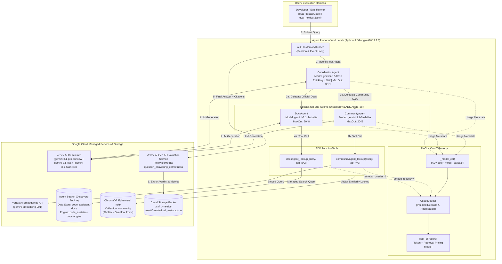
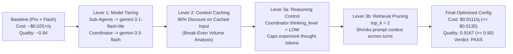

# High-Level Design (HLD): Code Assistant Multi-Agent Cost Optimization

## 1. Executive Summary & Architectural Goals

Modern enterprise agentic systems rarely invoke a single Large Language Model (LLM) prompt. Instead, a single user query triggers a **multi-agent fan-out**: a top-level **Coordinator** plans the response, delegates specialized sub-tasks to domain-specific **Sub-Agents**, triggers **Retrieval-Augmented Generation (RAG)** across managed enterprise search engines and vector databases, consumes internal **reasoning (`thought`) tokens**, and finally synthesizes a grounded, cited answer.

Without granular cost observability, teams ship multi-agent applications where every seat defaults to a frontier reasoning model (`gemini-3.1-pro-preview`), driving unsustainable unit economics (`~$0.027+` per developer question).

The **Code Assistant Agent** architecture is designed around four core engineering goals:
1. **Accurate Multi-Source Grounding**: Combine authoritative product documentation (via managed **Agent Search / Discovery Engine**) with practical troubleshooting solutions (via a local **ChromaDB** vector store over Stack Overflow discussions).
2. **Zero-Blind-Spot FinOps Attribution**: Capture every billable event—prompt input tokens, cached prefix tokens, completion output tokens, internal reasoning (`thought`) tokens, vector embedding tokens, and managed search query fees—tagged by `agent`, `call_type`, `model`, and `query_id`.
3. **Continuous Quality Verification**: Automatically evaluate every architectural or configuration change against reference answers using the **Vertex AI Gen AI Evaluation Service** (`EvalTask`) with a reference-anchored correctness & completeness rubric.
4. **Systematic Cost-Quality Optimization**: Provide modular control knobs (`models`, `thinking_level`, `top_k`, `max_output_tokens`, and context caching) to cut cost per query by **~59%** (`$0.0111` vs `~$0.0270` baseline, well below the `$0.0135` budget) while maintaining answer quality at **`0.9167`** (above the `0.90` quality floor).

---

## 2. System Context & Topology

The system operates on **Google Cloud Platform (GCP)** within a managed **Agent Platform Workbench (`generative-ai-jupyterlab`)** environment and interacts with three managed Google Cloud APIs alongside an in-process vector database.

---

## 3. Core Architectural Subsystems

### 3.1 Multi-Agent Orchestration Subsystem (Google ADK)
The application uses the **Hierarchical Coordinator-Subagent Pattern** implemented with `google.adk.agents.Agent` and `google.adk.tools.agent_tool.AgentTool`:
- **`Coordinator` (Root Agent)**:
  - Acts as the orchestrator and final synthesizer.
  - Uses `AgentTool(sub_agent)` rather than `sub_agents` transfer so control always returns to the Coordinator for final answer synthesis.
  - Receives the developer's coding question or error message, calls `DocsAgent` and `CommunityAgent` to gather grounding, and synthesizes ONE concise answer that cites whether insights came from official docs or community discussion.
  - **Architectural Constraint**: Must run on `gemini-3.1-pro-preview` or `gemini-3.5-flash`. Experiments show `gemini-3.1-flash-lite` is too weak to handle complex multi-agent orchestration and synthesis.
- **`DocsAgent` (Specialist Sub-Agent)**:
  - Wrapped as an `AgentTool` exposed to the Coordinator.
  - Calls `docsagent_lookup` with the user's problem and answers strictly and concisely from the official documentation results.
- **`CommunityAgent` (Specialist Sub-Agent)**:
  - Wrapped as an `AgentTool` exposed to the Coordinator.
  - Calls `communityagent_lookup` with the user's problem and summarizes the most relevant prior Stack Overflow discussion.

### 3.2 Hybrid Retrieval-Augmented Generation (RAG) Subsystem
The architecture pairs two distinct enterprise retrieval patterns so their cost structures can be compared directly:

| Characteristic | Official Documentation (`DocsAgent`) | Community Knowledge (`CommunityAgent`) |
| :--- | :--- | :--- |
| **Backend Technology** | **Managed Agent Search (Discovery Engine)** (`code_assistant-docs-engine`) | **Local Vector Database (ChromaDB)** (`community`) |
| **Source Corpus** | [`assets/docs.jsonl`](./assets/docs.jsonl) (20 official troubleshooting & product docs) | [`assets/stackoverflow.jsonl`](./assets/stackoverflow.jsonl) (20 Stack Overflow Q&A threads) |
| **Indexing Mechanism** | Managed inline ingestion (`ImportDocumentsRequest.InlineSource` in `global`) | Client-side batch embedding via `gemini-embedding-001` (`query_id="__index__"`) into `chromadb.EphemeralClient()` |
| **Per-Query Cost Model** | Flat per-query search fee (`$1.50 / 1,000 queries` = `$0.0015` per query) | Per-token embedding fee (`$0.15 / 1M tokens` on `gemini-embedding-001` query text) + `$0` local vector lookup |
| **Context Footprint Control** | Controlled by `top_k` (default `5` / `3`, optimized to `2`) | Controlled by `top_k` (default `5` / `3`, optimized to `2`) |

### 3.3 FinOps Telemetry & Usage Ledger Subsystem
Rather than estimating token counts with heuristics, the system hooks directly into the ADK and tool execution lifecycle:
1. **Model Call Attribution (`after_model_callback`)**:
   - Every `Agent` registers a closure generated by `_model_cb(ledger, agent_name, model, qid_holder)`.
   - After each Gemini API turn, ADK passes `llm_response` to the callback, which extracts `usage_metadata`:
     - `prompt_token_count` and `cached_content_token_count` (recording `input_tokens = max(0, prompt - cached)` and `cached_tokens = cached` disjointly so no token is double-counted).
     - `candidates_token_count` (visible output tokens).
     - `thoughts_token_count` (internal reasoning tokens generated by Gemini 3 thinking models).
2. **Tool Call Attribution**:
   - Inside `docsagent_lookup`, each call to Discovery Engine records `call_type="retrieval"`, `model="vais_query"`, `retrieval_queries=1` under `agent="DocsAgent"`.
   - Inside `communityagent_lookup`, each call to `embed_texts` records `call_type="embedding"`, `model="embedding"`, `embed_tokens=tokens` under `agent="CommunityAgent"`.
3. **One-Time vs. Per-Query Separation**:
   - Corpus indexing embeddings are tagged with `query_id="__index__"`.
   - `UsageLedger.cost_per_query()` excludes `__index__` records when averaging cost across distinct user queries.

### 3.4 Automated LLM-as-a-Judge Evaluation Subsystem
Every configuration is scored using the **Vertex AI Gen AI Evaluation Service**:
- **Evaluation Datasets**:
  - **Development Set ([`assets/eval_dataset.jsonl`](./assets/eval_dataset.jsonl))**: Used during Parts 1–5 for iterative experimentation and trade-off visualization.
  - **Held-Out Set ([`assets/eval_holdout.jsonl`](./assets/eval_holdout.jsonl))**: 16 unseen developer troubleshooting questions (`h01`–`h16`) used in Part 6 for final grading.
- **Judge Metric & Rubric**:
  - Uses `PointwiseMetric(metric="question_answering_correctness")` with `PointwiseMetricPromptTemplate` anchored on `CRITERIA` (`correctness` and `completeness`) and `RATING_RUBRIC` (`1` to `5` integer scale).
  - Normalizes raw 1–5 mean judge scores (`mean5`) to a `[0.0, 1.0]` quality score via:
    $$\text{Quality} = \frac{\text{mean5} - 1.0}{4.0}$$
    A `0.90` quality floor corresponds to an average judge score of **4.60 / 5.00**.

---

## 4. Three-Lever Cost Optimization Architecture

### Lever 1: Asymmetric Model Tiering
- **Observation**: Sub-agents (`DocsAgent`, `CommunityAgent`) perform bounded lookup and summarization tasks. Running `gemini-3.5-flash` on sub-agents bills `$1.50/1M` input and `$9.00/1M` output (plus unpredictable thinking bursts), whereas `gemini-3.1-flash-lite` bills `$0.25/1M` input, `$1.50/1M` output, and `0` thought tokens.
- **Design Decision**:
  - Assign `DocsAgent` and `CommunityAgent` to **`gemini-3.1-flash-lite`**.
  - Assign `Coordinator` to **`gemini-3.5-flash`** (`$1.50/1M` input, `$9.00/1M` output), satisfying the architectural constraint while cutting Coordinator per-token rates by **25%** vs `gemini-3.1-pro-preview` (`$2.00/$12.00`).

### Lever 2: Context Caching & Break-Even Economics
- **Observation**: Cached input tokens are billed at **10% of the standard input rate** (`$0.20` vs `$2.00` on Pro; `$0.15` vs `$1.50` on Flash). However, explicit caches require a large static prefix and incur creation/storage overhead.
- **Design Decision**: Keep system instructions concise for low-volume runs and apply explicit caching only when repeated call volume $N$ exceeds the break-even threshold.

### Lever 3: Reasoning (`thinking_level="LOW"`) & Retrieval (`top_k=2`) Token Reduction
- **Observation**:
  1. In Gemini 3 models (`Pro` and `Flash`), `thought_tokens` are billed at the full output rate (`$12.00/1M` on Pro, `$9.00/1M` on Flash). With `thinking_level="HIGH"`, the Coordinator spends thousands of tokens reasoning on every turn.
  2. Retrieving `top_k=5` passages from both tools injects 10 documents into the conversation history, inflating both sub-agent and Coordinator prompt sizes.
- **Design Decision**:
  - Set `thinking_level = "LOW"` on the Coordinator, reducing Coordinator thought tokens across 16 queries to just `4,561` total (~`285` per query).
  - Set `top_k = 2` on both retrieval tools, reducing retrieved passage context by 60% while retaining `0.9167` answer quality.

---

## 5. Non-Functional Requirements & Guardrails

| Requirement Category | Specification | Implementation Mechanism |
| :--- | :--- | :--- |
| **Cost Budget** | $\le \$0.0135$ USD per query | Enforced by `check_challenge_pass()` in Part 6. Achieved **`$0.011135`**. |
| **Quality Floor** | $\ge 0.90$ normalized score | Enforced by `check_challenge_pass()` in Part 6. Achieved **`0.9167`**. |
| **Coordinator Model Guardrail** | Cannot use `gemini-3.1-flash-lite` | Validated via assertion in Part 6 (`MY_MODELS["coordinator"] != "gemini-3.1-flash-lite"`). |
| **Embedding Model Guardrail** | Must remain `gemini-embedding-001` | Validated via assertion in Part 6 (`MY_MODELS["embedding"] == "gemini-embedding-001"`). |
| **Resilience & Rate Limiting** | Automatic exponential backoff on HTTP 408/429/5xx | Configured via `types.HttpRetryOptions()` on Gemini models and `core_retry.Retry` on Discovery Engine. |
| **Runaway Generation Protection** | Hard output token ceilings | `SUBAGENT_MAX_OUTPUT = 2048` and `COORDINATOR_MAX_OUTPUT = 3072` in `code_assistant/agents.py`. |
