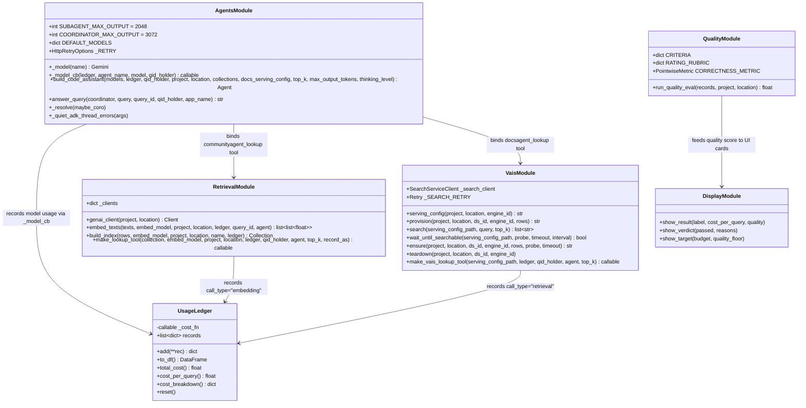

# Low-Level Design (LLD): Code Assistant Package & Cost Engine Internals

## 1. Package Overview & Module Dependency Graph

The implementation is modularized into the `code_assistant` Python package ([`code_assistant/`](./code_assistant/)) and orchestrated from [`code_assistant_cost_optimization.ipynb`](./code_assistant_cost_optimization.ipynb) (or headless via [`run_lab.py`](./run_lab.py)).



---

## 2. Detailed Module Specifications

### 2.1 [`code_assistant/ledger.py`](./code_assistant/ledger.py) — Cost & Usage Ledger
`UsageLedger` is an in-memory accounting ledger that stores one record per billable event (`call_type` in `{"model", "embedding", "retrieval"}`). Pricing stays in the notebook (`cost_of(record)`) and is injected at construction (`UsageLedger(cost_of)`).

#### Record Schema (`ledger.add(**rec)`)
Each entry appended to `self.records` is a Python `dict` with defaults initialized to `0`:
```python
{
    "query_id":          str,    # e.g., "0", "1", ..., "15", or "__index__" for one-time index build
    "agent":             str,    # "Coordinator" | "DocsAgent" | "CommunityAgent" | "index"
    "call_type":         str,    # "model" | "embedding" | "retrieval"
    "model":             str,    # e.g., "gemini-3.5-flash", "gemini-3.1-flash-lite", "embedding", "vais_query"
    "input_tokens":      int,    # Non-cached input prompt tokens (max(0, prompt - cached))
    "cached_tokens":     int,    # Prefix tokens served from cache (cached_content_token_count)
    "output_tokens":     int,    # Visible completion tokens (candidates_token_count)
    "thought_tokens":    int,    # Internal reasoning tokens (thoughts_token_count)
    "retrieval_queries": int,    # Number of managed Agent Search requests (0 or 1)
    "embed_tokens":      int,    # Embedding input tokens billed by gemini-embedding-001
    "cost_usd":          float,  # Computed immediately via self._cost_fn(rec)
}
```

#### Key Methods
- **`add(**rec) -> dict`**: Populates default numeric fields (`0`), computes `rec["cost_usd"] = self._cost_fn(rec)`, appends to `self.records`, and returns `rec`.
- **`to_df() -> pd.DataFrame`**: Converts `self.records` into a pandas DataFrame for slice-and-dice analysis.
- **`total_cost() -> float`**: Returns `round(sum(r["cost_usd"] for r in self.records), 12)`.
- **`cost_per_query() -> float`**:
  - Groups `cost_usd` by `query_id`, explicitly skipping `qid == "__index__"` (one-time index build).
  - Returns the mean cost across all evaluated queries (`round(sum(totals.values()) / len(totals), 12)`).
- **`cost_breakdown() -> dict`**: Returns total USD aggregated by `agent` (`{"Coordinator": ..., "DocsAgent": ..., "CommunityAgent": ...}`).

---

### 2.2 Cost Model (`PRICING` & `cost_of`)
Defined in [`code_assistant_cost_optimization.ipynb`](./code_assistant_cost_optimization.ipynb) and passed into `UsageLedger(cost_of)`.

#### Price Table (`PRICING`)
```python
PRICING = {
    # Model ID                   Input ($/1M)   Cached ($/1M)   Output & Thought ($/1M)
    "gemini-3.1-pro-preview":   {"input": 2.00, "cached": 0.20,  "output": 12.00},
    "gemini-3.5-flash":         {"input": 1.50, "cached": 0.15,  "output":  9.00},
    "gemini-3.1-flash-lite":    {"input": 0.25, "cached": 0.025, "output":  1.50},
    "gemini-2.5-pro":           {"input": 1.25, "cached": 0.13,  "output": 10.00},
    "gemini-2.5-flash":         {"input": 0.30, "cached": 0.03,  "output":  2.50},
    "embedding":                {"per_1m_tokens": 0.15},
    "vais_query":               {"per_1k_queries": 1.50},  # $0.0015 per Agent Search query
}
```

#### Cost Calculation Function (`cost_of(record)`)
```python
def cost_of(record):
    ct = record.get("call_type")
    if ct == "model":
        p = PRICING[record["model"]]
        out = record.get("output_tokens", 0) + record.get("thought_tokens", 0)
        return round((record.get("input_tokens", 0) * p["input"]
                      + record.get("cached_tokens", 0) * p["cached"]
                      + out * p["output"]) / 1e6, 12)
    if ct == "embedding":
        return round(record.get("embed_tokens", 0) * PRICING["embedding"]["per_1m_tokens"] / 1e6, 12)
    if ct == "retrieval":
        return round(record.get("retrieval_queries", 0) * PRICING["vais_query"]["per_1k_queries"] / 1e3, 12)
    return 0.0
```

> **Critical Engineering Detail**: Notice `out = record.get("output_tokens", 0) + record.get("thought_tokens", 0)`. Internal reasoning (`thought_tokens`) are billed at the **full output token rate** (`$12.00 / 1M` on Pro, `$9.00 / 1M` on Flash)—which is **6x more expensive** than input tokens.

---

### 2.3 [`code_assistant/agents.py`](./code_assistant/agents.py) — Multi-Agent Builder & ADK Callbacks

#### Output Ceilings & Retry Policy
- `_RETRY = types.HttpRetryOptions()`: Wraps every `Gemini(model=name, retry_options=_RETRY)` instance so transient HTTP 408/429/5xx errors retry with exponential backoff.
- `SUBAGENT_MAX_OUTPUT = 2048`: Caps `DocsAgent` and `CommunityAgent` responses.
- `COORDINATOR_MAX_OUTPUT = 3072`: Bounds the `Coordinator`'s combined thoughts + answer tokens to prevent runaway 65k-token generations.

#### Callback Hook (`_model_cb`)
```python
def _model_cb(ledger, agent_name, model, qid_holder):
    """ADK after_model_callback that records one model billing event."""
    def cb(callback_context, llm_response):
        um = getattr(llm_response, "usage_metadata", None)
        if um is not None:
            prompt = getattr(um, "prompt_token_count", 0) or 0
            cached = getattr(um, "cached_content_token_count", 0) or 0
            ledger.add(query_id=qid_holder["v"], agent=agent_name, call_type="model", model=model,
                       input_tokens=max(0, prompt - cached),
                       cached_tokens=cached,
                       output_tokens=getattr(um, "candidates_token_count", 0) or 0,
                       thought_tokens=getattr(um, "thoughts_token_count", 0) or 0)
        return None
    return cb
```
- **Why `max(0, prompt - cached)`?**: `prompt_token_count` includes `cached_content_token_count`. Subtracting `cached` ensures each prompt token is priced once (either at the full input rate or at the 90%-discounted cached rate).

#### Agent Hierarchy Construction (`build_code_assistant`)
1. **Docs Tool (`docsagent_lookup`)**: Uses `make_vais_lookup_tool(docs_serving_config, ...)` when managed Agent Search is configured, or falls back to local Chroma stand-in with `record_as="vais"`.
2. **Community Tool (`communityagent_lookup`)**: Uses `make_lookup_tool(collections["community"], ..., record_as="embedding")`.
3. **Sub-Agents (`DocsAgent`, `CommunityAgent`)**: Configured with `FunctionTool(docs_tool)` and `FunctionTool(comm_tool)`, `max_output_tokens=SUBAGENT_MAX_OUTPUT`, and their own `_model_cb`.
4. **Coordinator (`Coordinator`)**:
   - Configured with `tools=[AgentTool(agent=docs_agent), AgentTool(agent=community_agent)]` so control returns to the Coordinator for final answer synthesis.
   - Applies `types.ThinkingConfig(thinking_level=thinking_level)` when `thinking_level` (`"MINIMAL"`, `"LOW"`, `"MEDIUM"`, `"HIGH"`) is specified.

#### Thread-Safe Query Execution (`answer_query`, `_resolve`, `_quiet_adk_thread_errors`)
- Installs a custom `threading.excepthook` (`_quiet_adk_thread_errors`) to capture exceptions raised inside ADK's background `_asyncio_thread_main` worker thread.
- `_resolve(maybe_coro)` transparently runs coroutines whether called from a standard Python script (`asyncio.run`) or inside a running Jupyter event loop (`ThreadPoolExecutor(1)`).
- `answer_query` sets `qid_holder["v"] = query_id`, runs `InMemoryRunner`, extracts the final response text, and raises a `RuntimeError` if the run produced an empty answer.

---

### 2.4 [`code_assistant/retrieval.py`](./code_assistant/retrieval.py) — Embeddings, ChromaDB, & Lookup Tools

- **`genai_client(project, location)`**: Caches a `genai.Client(vertexai=True, ...)` per `(project, location)` with `HttpRetryOptions()` enabled.
- **`embed_texts(texts, embed_model, project, location, ledger=None, query_id="_", agent="embedding")`**:
  - Calls `client.models.embed_content(model=embed_model, contents=texts)`.
  - Reads `e.statistics.token_count` from each embedding response (falling back to `len(t) // 4`) and records `call_type="embedding"`, `model="embedding"`, `embed_tokens=tokens` in `ledger`.
- **`build_index(rows, embed_model, project, location, *, name="corpus", ledger=None)`**:
  - Creates an in-memory `chromadb.EphemeralClient()` collection.
  - Embeds all `r["text"]` entries with `query_id="__index__"` and adds `ids`, `documents`, and `embeddings` to ChromaDB.
- **`make_lookup_tool(...)`**:
  - Returns `lookup(query: str) -> str` named `f"{agent.lower()}_lookup"` (`communityagent_lookup` or `docsagent_lookup`).
  - Embeds the query, retrieves `n_results=top_k` from ChromaDB, and bills either `record_as="embedding"` or `record_as="vais"`.

---

### 2.5 [`code_assistant/vais.py`](./code_assistant/vais.py) — Managed Agent Search (Discovery Engine)

Manages the real Google Cloud Discovery Engine (`discoveryengine_v1`) data store and search engine:
- **`provision(project, location, ds_id, engine_id, rows)`**:
  1. Creates `DataStore` (`id="code_assistant-docs"`, `IndustryVertical.GENERIC`, `SolutionType.SOLUTION_TYPE_SEARCH`, `ContentConfig.NO_CONTENT`).
  2. Imports the 20 JSON documents inline (`ImportDocumentsRequest.InlineSource`, `ReconciliationMode.INCREMENTAL`).
  3. Creates `Engine` (`id="code_assistant-docs-engine"`, `SearchTier.SEARCH_TIER_STANDARD`).
- **`search(serving_config_path, query, top_k=5)`**:
  - Reuses a singleton `de.SearchServiceClient()` with explicit transient-error retry (`_SEARCH_RETRY`).
  - Extracts `text` from `struct_data`, `derived_struct_data`, or `json_data`.
- **`ensure(project, location, ds_id, engine_id, rows, *, probe="KeyError", timeout=600)`**:
  - Fast-path probes `search(sc, "KeyError", top_k=1)`; if already searchable, reuses the existing engine immediately.
  - Otherwise calls `provision(...)` followed by `wait_until_searchable(...)` (polling every 20 seconds up to 600s).
- **`make_vais_lookup_tool(serving_config_path, ledger, qid_holder, *, agent="DocsAgent", top_k=5)`**:
  - Creates `docsagent_lookup(query: str) -> str`, which calls `search(...)` and logs `call_type="retrieval"`, `model="vais_query"`, `retrieval_queries=1` into `ledger`.

---

### 2.6 [`code_assistant/quality.py`](./code_assistant/quality.py) — Vertex AI Gen AI Evaluation Service

- **Rubric Definition (`CRITERIA` & `RATING_RUBRIC`)**:
  - Evaluates `correctness` (agrees with reference answer, no contradictions) and `completeness` (covers all essential points of the reference answer) on a `1` to `5` scale via `PointwiseMetric(metric="question_answering_correctness", ...)`.
- **`run_quality_eval(records, project, location)`**:
  - Initializes `vertexai.init(project=project, location=location)`.
  - Constructs a `pd.DataFrame` with `prompt`, `response`, and `reference`.
  - Runs `EvalTask(dataset=df, metrics=[CORRECTNESS_METRIC]).evaluate()` (with a 1-retry wrapper for transient service errors).
  - Reads `summary_metrics["question_answering_correctness/mean"]` (`mean5`) and normalizes from `[1, 5]` to `[0.0, 1.0]`:
    $$\text{quality} = \text{round}\left(\max\left(0.0,\ \min\left(1.0,\ \frac{\text{mean5} - 1}{4}\right)\right),\ 4\right)$$

---

## 3. Data & Asset Schemas

### 3.1 Corpus Files (`assets/docs.jsonl` & `assets/stackoverflow.jsonl`)
Each line is a JSON object with `id`, `title`, and `text`:
```json
{
  "id": "doc_01",
  "title": "Cloud Run: Container failed to start ($PORT)",
  "text": "Official Docs (Cloud Run troubleshooting): Your container must listen for HTTP requests on the port defined by the PORT environment variable..."
}
```

### 3.2 Evaluation Datasets (`assets/eval_dataset.jsonl` & `assets/eval_holdout.jsonl`)
- [`assets/eval_dataset.jsonl`](./assets/eval_dataset.jsonl): Development queries used in Parts 1–5.
- [`assets/eval_holdout.jsonl`](./assets/eval_holdout.jsonl): 16 held-out grading queries (`h01`–`h16`) used in Part 6.
```json
{
  "id": "h01",
  "query": "My Cloud Functions gen2 deploy fails with: Container Healthcheck failed: failed to start and then listen on the port defined by the PORT environment variable. Works locally on port 3000.",
  "reference": "Cloud Functions gen2 runs on Cloud Run and injects PORT (default 8080). Read os.environ.get('PORT', 8080) and bind to 0.0.0.0, not localhost or a hardcoded 3000."
}
```

### 3.3 Final Grading Output Schema ([`final_metrics.json`](./final_metrics.json))
Written locally to `final_metrics.json` and uploaded to `gs://<PROJECT_ID>-metrics-result/results/final_metrics.json`:
```json
{
  "cost_per_query": 0.01113525,
  "quality": 0.9167,
  "budget": 0.0135,
  "quality_floor": 0.9,
  "passed": true
}
```
