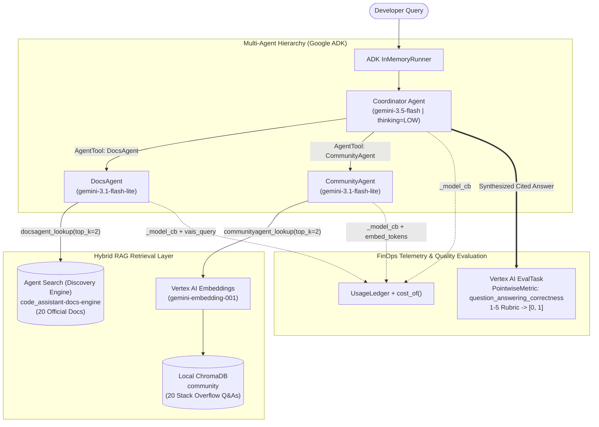

# Code Assistant Agent: Multi-Agent Cost Measurement & Optimization Runbook

[](#final-challenge-results)
[-blue)](#final-challenge-results)
[-brightgreen)](#final-challenge-results)
[](https://google.github.io/adk-docs/)

A complete end-to-end engineering runbook, High-Level Design (HLD), Low-Level Design (LLD), execution workflow, and Antigravity (AGY) session log for **Measure & Optimize the Cost of a Multi-Agent Code Assistant** built on the **Google Agent Development Kit (ADK)**, **Agent Search (Discovery Engine)**, **ChromaDB**, and **Vertex AI Gen AI Evaluation Service**.

---

## Documentation Index

| Document | Description |
| :--- | :--- |
| [**`RUNBOOK.md`**](./RUNBOOK.md) | Step-by-step operational runbook covering Lab Tasks 1–5, Notebook Parts 0–6, headless execution (`run_lab.py`), verification, and troubleshooting. |
| [**`HIGH_LEVEL_DESIGN.md`**](./HIGH_LEVEL_DESIGN.md) | High-Level Design (HLD): multi-agent topology, hybrid RAG architecture, FinOps telemetry model, evaluation pipeline, and optimization levers. |
| [**`LOW_LEVEL_DESIGN.md`**](./LOW_LEVEL_DESIGN.md) | Low-Level Design (LLD): module-by-module internals of `code_assistant/`, ADK callbacks, retry policies, pricing math, and JSON schemas. |
| [**`WORKFLOW.md`**](./WORKFLOW.md) | End-to-End Workflows: sequence and state diagrams for provisioning, query fan-out, cost attribution, LLM judge scoring, and hill-climbing. |
| [**`ARCHITECTURE_AND_DESIGN.md`**](./ARCHITECTURE_AND_DESIGN.md) | Unified master architecture reference combining HLD, LLD, and Workflows in a single document. |
| [**`AGY_SESSION_HISTORY.md`**](./AGY_SESSION_HISTORY.md) | Complete chronological transcript summary and execution log from the Antigravity (AGY) agent session. |

---

## Executive Overview

Agentic applications drive significant model and service costs because a single user question fans out into:
1. **Repeated Coordinator LLM calls** (planning which sub-agents to invoke and synthesizing their outputs).
2. **Sub-Agent LLM calls** (`DocsAgent` and `CommunityAgent` formulating search queries and summarizing retrieved passages).
3. **Retrieval & Embedding calls** (managed Agent Search query fees + `gemini-embedding-001` query embeddings).
4. **Reasoning (`thought`) tokens** (internal chain-of-thought tokens billed at the full output token rate across every Gemini 3 model call).

In this project, we instrument a 3-agent **Code Assistant Agent** with a granular `UsageLedger`, establish its baseline cost and answer quality, systematically apply three cost-optimization levers (**Model Tiering**, **Context Caching**, and **Reasoning & Retrieval Token Reduction**), and pass the graded production challenge on a held-out dataset of 16 complex developer queries.

---

## System Architecture at a Glance



---

## Optimization Levers & Progression Summary

| Step | Configuration / Lever Applied | Coordinator Model | Sub-Agent Models | Thinking Level | Retrieval `top_k` | Key Cost & Quality Insight |
| :--- | :--- | :--- | :--- | :--- | :--- | :--- |
| **Baseline** | `Baseline (Pro + Flash)` | `gemini-3.1-pro-preview` | `gemini-3.5-flash` | `HIGH` | `3` | High accuracy (`~0.94`), but expensive (`~$0.025+`/query) due to Pro/Flash output & thought tokens across all 3 seats. |
| **Lever 1a** | `1a. Sub-agents -> Flash-Lite` | `gemini-3.1-pro-preview` | `gemini-3.1-flash-lite` | `HIGH` | `3` | Eliminates sub-agent thinking tokens (`0` thought tokens) and drops sub-agent I/O rates (`$0.25/$1.50`). Coordinator becomes the dominant cost driver. |
| **Lever 1b** | `1b. Coordinator -> Flash` | `gemini-3.5-flash` | `gemini-3.1-flash-lite` | `HIGH` | `3` | Cuts Coordinator token rates (`$1.50/$9.00` vs `$2.00/$12.00`), though uncapped `HIGH` thinking on Flash causes high reasoning token spend. |
| **Lever 2** | `Context Caching` | Prefix / Explicit Cache | Prefix / Explicit Cache | N/A | N/A | 90% discount on `cached_tokens` (`0.1x` input rate). Economical when prompt prefix exceeds minimum token threshold and call volume amortizes cache creation. |
| **Lever 3** | `Reasoning & Retrieval Reduction` | `gemini-3.5-flash` | `gemini-3.1-flash-lite` | `LOW` | `2` | Caps Coordinator reasoning budget (`thinking_level="LOW"`) and trims retrieved passages to `top_k=2`, slashing both thought tokens and prompt context size. |
| **Final Challenge** | **`Final challenge (held-out)`** | **`gemini-3.5-flash`** | **`gemini-3.1-flash-lite`** | **`LOW`** | **`2`** | **Meets all architectural rules, slashes cost to `$0.0111`/query (`<= $0.0135`), and achieves `0.9167` quality (`>= 0.90`).** |

---

## Final Challenge Results

Evaluated on the 16 held-out developer queries in [`assets/eval_holdout.jsonl`](./assets/eval_holdout.jsonl) and exported to [`final_metrics.json`](./final_metrics.json) (and uploaded to `gs://qwiklabs-gcp-04-c43b8d6f39fd-metrics-result/results/final_metrics.json`):

```json
{
  "cost_per_query": 0.01113525,
  "quality": 0.9167,
  "budget": 0.0135,
  "quality_floor": 0.9,
  "passed": true
}
```

### Per-Agent Cost Breakdown Across 16 Held-Out Queries

| Agent | Model | Input Tokens | Thought Tokens | Output Tokens | Retrieval / Embed Fee | Total Cost (16 Queries) | Cost / Query |
| :--- | :--- | ---: | ---: | ---: | :--- | ---: | ---: |
| **Coordinator** | `gemini-3.5-flash` (`LOW`) | 15,153 | 4,561 | 9,632 | `$0.000000` | `$0.150467` | `$0.009404` |
| **DocsAgent** | `gemini-3.1-flash-lite` | 3,829 | 0 | 2,700 | `10` Search Queries (`$0.015000`) | `$0.020007` | `$0.001250` |
| **CommunityAgent** | `gemini-3.1-flash-lite` | 3,620 | 0 | 4,513 | `191` Embed Tokens (`$0.000029`) | `$0.007690` | `$0.000481` |
| **Total** | — | **22,602** | **4,561** | **16,845** | **`$0.015029`** | **`$0.178164`** | **`$0.011135`** |

---

## Repository Structure

```text
.
├── README.md                                 # Executive summary, architecture, results, and navigation index
├── RUNBOOK.md                                # Complete step-by-step operational & execution runbook
├── HIGH_LEVEL_DESIGN.md                      # High-Level Design (HLD) with system & component diagrams
├── LOW_LEVEL_DESIGN.md                       # Low-Level Design (LLD) with module specs, schemas, and pricing math
├── WORKFLOW.md                               # End-to-end execution, evaluation, and optimization workflows
├── ARCHITECTURE_AND_DESIGN.md                # Unified master architecture & design document
├── AGY_SESSION_HISTORY.md                    # Chronological log of the Antigravity (AGY) execution session
├── code_assistant_cost_optimization.ipynb    # Completed lab notebook with Part 6 solution configured
├── run_lab.py                                # Standalone headless execution script for provisioning & Part 6 grading
├── final_metrics.json                        # Verified PASS evaluation output uploaded to GCS grading bucket
├── requirements.txt                          # Frozen Python environment dependencies
├── notebook_config.sh                        # Workbench startup & GCS asset sync script
├── code_assistant/                           # Core multi-agent & FinOps instrumentation package
│   ├── __init__.py                           # Package docstring
│   ├── agents.py                             # ADK Coordinator + Sub-Agents builder, callbacks, runner
│   ├── data.py                               # JSONL loader helper
│   ├── display.py                            # Jupyter HTML metric & PASS/FAIL banner cards
│   ├── ledger.py                             # UsageLedger class for per-call token & query accounting
│   ├── quality.py                            # Vertex AI EvalTask wrapper & 1-5 score normalizer
│   ├── retrieval.py                          # ChromaDB builder, embedding wrapper, ADK lookup tools
│   └── vais.py                               # Discovery Engine (Agent Search) provisioning & search
└── assets/                                   # Retrieval corpora and evaluation datasets
    ├── docs.jsonl                            # 20 official documentation passages for Agent Search
    ├── stackoverflow.jsonl                   # 20 community Q&A threads for ChromaDB vector index
    ├── eval_dataset.jsonl                    # Development queries with reference answers (Parts 1-5)
    └── eval_holdout.jsonl                    # 16 held-out grading queries with reference answers (Part 6)
```
