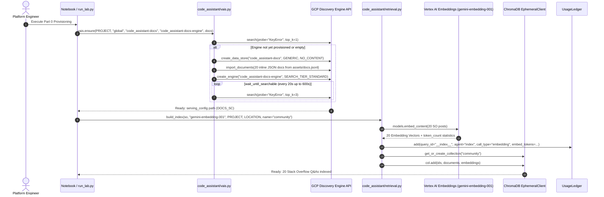
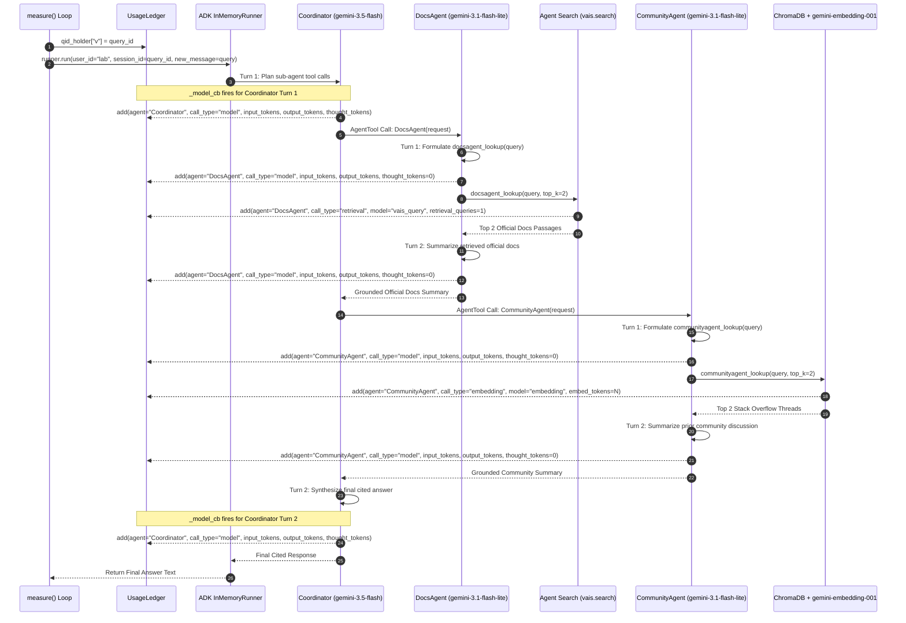
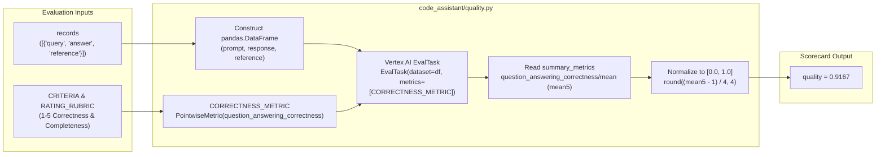
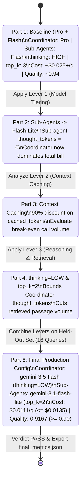
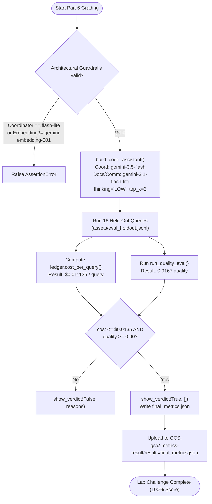

# End-to-End Workflows: Multi-Agent Execution, Cost Attribution & Optimization

This document details the operational and runtime workflows of the **Code Assistant Agent** system across five core lifecycles:
1. **Infrastructure & Retrieval Corpus Provisioning Workflow**
2. **Runtime Multi-Agent Query Fan-Out & Cost Attribution Sequence**
3. **Automated LLM-as-a-Judge Quality Evaluation Workflow**
4. **Iterative FinOps Cost-Quality Optimization Workflow**
5. **Graded Final Challenge Verification & Artifact Export Workflow**

---

## 1. Infrastructure & Retrieval Corpus Provisioning Workflow

Before any developer query can be answered, Part 0 provisions two retrieval backends:
1. **Managed Agent Search (`code_assistant-docs-engine`)** in `global` for official documentation ([`assets/docs.jsonl`](./assets/docs.jsonl)).
2. **Local ChromaDB Ephemeral Vector Store (`community`)** in memory for community Stack Overflow Q&As ([`assets/stackoverflow.jsonl`](./assets/stackoverflow.jsonl)).

---

## 2. Runtime Multi-Agent Query Fan-Out & Cost Attribution Sequence

When `answer_query(coordinator, query, query_id, qid_holder)` runs on a single developer question, a multi-turn conversation unfolds across the `Coordinator`, `DocsAgent`, and `CommunityAgent`. Every LLM turn and retrieval lookup is intercepted and recorded in `UsageLedger`.

### Why Baseline Fan-Out Is Expensive
As shown in the sequence above, **1 user query fans out into up to 6 LLM API calls + 1 Agent Search query + 1 Embedding API call**:
- **2 Coordinator LLM calls** (Turn 1 planning + Turn 2 synthesis over retrieved summaries).
- **2 DocsAgent LLM calls** (Turn 1 tool call formulation + Turn 2 extraction over retrieved docs).
- **2 CommunityAgent LLM calls** (Turn 1 tool call formulation + Turn 2 extraction over retrieved SO posts).

---

## 3. Automated LLM-as-a-Judge Quality Evaluation Workflow

After running a configuration across an evaluation dataset (`eval_dataset` or `eval_holdout`), `run_quality_eval(records, project, location)` scores every response against ground-truth reference answers.

---

## 4. Iterative FinOps Optimization Workflow

The lab guides the engineer through a disciplined Measure $\rightarrow$ Optimize $\rightarrow$ Verify loop across Parts 1–6:

---

## 5. Graded Final Challenge Verification & Artifact Export Workflow

In Part 6, the grading workflow enforces architectural constraints, evaluates all 16 held-out queries in `assets/eval_holdout.jsonl`, verifies the budget and quality thresholds, and uploads `final_metrics.json` to the Qwiklabs grading bucket.

